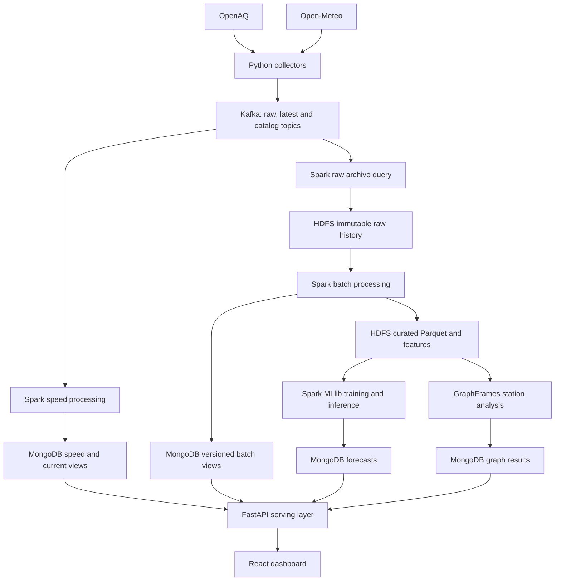

# Architecture

The [detailed system design](system-design.md) is the authoritative design. The assessed deployment uses Lambda architecture with Kafka, PySpark, HDFS, MongoDB, Kubernetes, Spark MLlib, and GraphFrames.

## First executable path

```text
Synthetic JSONL fixture → validation and normalization → revision selection → hourly JSON results
```

`python3 -m streaming.replay data/sample_measurements.jsonl` runs this path without infrastructure. `streaming/measurements.py` contains the initial hourly PM2.5 rules; `streaming/replay.py` handles bounded replay and reporting. These rules and their tests provide a reference for subsequent Spark implementations. The local path has no durable state and does not demonstrate cluster operation or distributed write guarantees.

## Implemented collector path

```text
OpenAQ / Open-Meteo → collectors → Kafka → Spark Structured Streaming → MongoDB serving
```

The `pipeline` (or `collectors`) Compose profile runs MongoDB, Kafka, the crawler
and Spark. Kafka has three source-data topics and a `source_catalog` metadata
topic. The collector's separate control database retains jobs, quotas, metadata
caches, captured responses and the outbox; these are not serving projections.
Outbox publication waits for Kafka acknowledgement. Spark validates input on
executor partitions and writes guarded measurement revisions, weather vintages,
latest snapshots and catalog projections into the serving database. Durable
checkpoints resume Kafka offsets; malformed events retain original bytes in
`stream_rejections`. See [pipeline operation](streaming.md).

The collector now covers the complete global OpenAQ catalog and all returned
parameters. `database.MongoDB` owns storage and bounded reads; persistent leased
jobs coordinate daily discovery, hourly latest sweeps, triggered detail queries
and background reconciliation. Latest snapshots are separate from interval facts.
See [collection operations](collectors.md), [schema](mongodb-schema.md) and
[source status](source-feasibility.md). HDFS, hourly serving views and the assessed
kind deployment remain pending.

## Target data flow



Collectors poll the two providers independently. Weather is associated with stations using an explicit coordinate/location mapping. Raw archival and speed processing progress independently. Both speed and batch paths must apply equivalent validation, unit, revision, and aggregation policies.

Batch jobs rebuild corrected history from a fixed archive snapshot. FastAPI selects published batch results for keys whose latest processed input is covered, and speed results for newer changes or missing batch keys. Every result exposes its serving provenance.

## Folder responsibilities

| Folder | Responsibility |
| --- | --- |
| `config/` | Selected stations, cadence, polling intervals, unit/quality rules, and model settings. |
| `collectors/` | Provider discovery, polling, adapters, and durable source progress. |
| `streaming/` | Kafka manager, Spark-to-MongoDB projection pipeline and local replay; future HDFS archive, hourly speed views and batch jobs. |
| `ml/` | Features, chronological evaluation, MLlib training/inference, and graph analysis entry points. |
| `api/` | FastAPI endpoints, MongoDB queries, and speed/batch serving selection. |
| `dashboard/` | React UI using FastAPI. |
| `infra/` | kind/Kubernetes manifests, topic setup, MongoDB indexes, and runtime configuration. |
| `tests/` | Processing regression checks, fixtures, and future integration/failure checks. |
| `data/` | Small labeled samples; generated local outputs in ignored directories. |
| `docs/` | Design, contracts, implementation sequence, and future operational/evidence documentation. |

Keep the component structure small. Add service-specific dependencies when those services are implemented; the first local slice requires only Python 3.11+.

## Reliability and deployment

Use stable observation identities, separate payload revisions, and UTC timestamps. Retain original collection metadata during replay. Resolve current revisions before aggregation so corrections replace earlier contributions, including when a correction makes a reading unusable.

HDFS stores immutable raw events, curated history, models, and checkpoints. MongoDB stores regular collections with deterministic keys, guarded updates, and station/time indexes. Target at-least-once delivery with exactly-once logical effects for tested projections; this requires distributed integration and failure tests beyond the local demo.

Run the assessed services on kind with persistent volumes. Spark runs directly on Kubernetes. The detailed design specifies the node layout, HDFS replication, streaming query separation, batch publication, and recovery scenarios.
