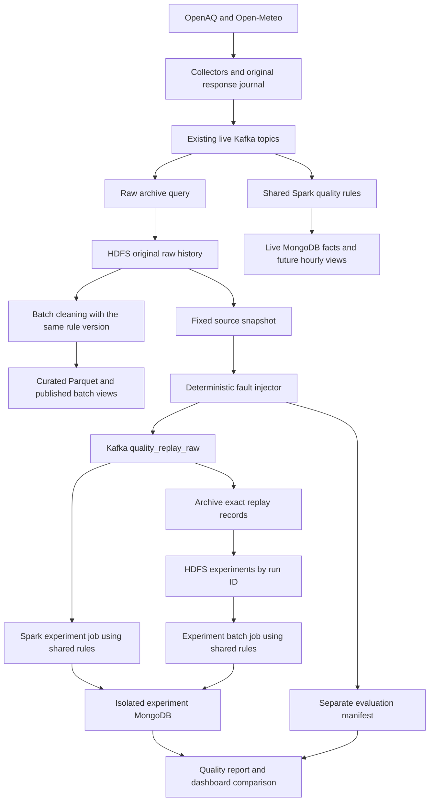

# Dirty-data processing and quality experiments

Status: **proposed architecture extension with inactive placeholder modules**. The local
PM2.5 replay and Spark source-fact projections already validate, normalize,
resolve revisions and retain rejected records. The fault injector, replay topic,
extended repair rules, quality views and experiments below are not implemented.
The [system design](system-design.md) remains authoritative for the whole system.
See the [implementation map](data-quality-implementation.md) for placeholder
locations, required changes to existing code and the build order.

## Purpose

Make data preparation a visible, measurable part of the air-quality project:
show what arrived, which problems were found, what could be repaired, what was
excluded, and how the result affects hourly concentrations and forecasting.

A structured API response does not establish measurement quality. First profile
real data for nulls, source flags, repeated deliveries, revisions, reporting
periods, units and gaps. OpenAQ distinguishes measurements and aggregations and
provides period/coverage metadata; preserve those distinctions rather than
assuming every row is a complete hourly reading.
[OpenAQ measurement documentation](https://docs.openaq.org/resources/measurements)

Use a controlled corruption experiment to guarantee interesting processing
cases even when a collected sample has few natural defects. Call these
**injected faults**, and report them separately from observed source problems.
Keep API collection and the existing technology stack.

## Architecture change

The live path continues to process unmodified provider data. The experiment is
an alternate input to the same processing logic, with a separate writer, database
and checkpoints. It does not sit between live collection and monitoring. For a
small first implementation, use the existing captured responses or a frozen
JSONL sample before HDFS is available; record exactly which input was used.
Never regenerate experiments by calling a changing API again.

Archive both the original source snapshot and every emitted replay record,
including malformed bytes. Organize HDFS outputs into original raw, normalized
observations, curated hourly/features, quarantine, and experiment evidence.
These are storage stages within the existing Lambda architecture, not additional
services. Continue using the collector response journal until archival exists.

## Reproducible fault injection

Implement one bounded Python replay producer, provisionally
`streaming/quality_replay.py`, rather than another long-running service. The
module has inactive stubs; its CLI and publication behavior are not implemented.
Use existing Kafka publication utilities.
Initially replay detailed hourly PM2.5 events and the matching unmodified catalog;
keep weather vintages unmodified so the first experiment stays manageable.

Each run records an immutable manifest containing:

- `run_id`, source snapshot checksum and input record count.
- Injector version, random seed, profile, rule version and code revision.
- Frozen catalog snapshot, timezone/unit policy versions and event order.
- Per-input lineage, chosen faults, original and emitted byte hashes, omitted
  records, output delivery IDs and expected outcomes where knowable.
- A deterministic release schedule, actual publish/processing times, final
  per-partition offset cutoffs and completion status.

Use a stable hash of the seed, input record identity and fault name for selection;
do not depend on Python's process-randomized `hash()`. Order input deterministically
and persist mutation parameters. A retry publishes the same delivery IDs and
bytes; an intentional duplicate gets its own delivery ID and identical payload.
Record restart/duplicate attempts separately from planned emitted deliveries.

Start with single-fault profiles and an unchanged control run. Then use a
`mixed-v1` profile: select 20% of baseline deliveries deterministically and assign
one primary fault to each, balanced across the enabled fault types. Duplicates
can increase emitted count; omissions reduce it. Report both the selected-input
rate and actual emitted/dropped counts. These are demonstration settings, not
claims about defect rates in OpenAQ. Add compound faults only with explicit
expected precedence and outcomes.

| Fault | Example | Planned processing response |
| --- | --- | --- |
| Duplicate delivery | Same sensor/hour/content sent twice | Retain both raw deliveries; one current observation and aggregate contribution. |
| Supported unit variation | `35 ug/m3` becomes `0.035 mg/m3` | Convert to `35 ug/m3`; preserve the received value/unit and conversion action. |
| Numeric string | `35` becomes `" 35.0 "` | Explicit finite decimal parsing under a versioned repair policy; record the repair. Reject ambiguous strings. |
| Missing/invalid value | `null`, `-5`, or `"unknown"` | Null/negative values remain flagged observations; unparseable values enter quarantine. Never replace them with zero. |
| Equivalent timezone | `08:00Z` becomes `15:00+07:00` | Normalize to the same UTC instant and logical identity. A timezone-free timestamp is quarantined unless a documented source policy resolves it. |
| Broken structure or unit | Truncated JSON, missing station ID, or `ppm` for PM2.5 | Preserve exact bytes and reason; quarantine structural failures and flag unsupported units. Do not guess identities or gas conversions. |
| Delay and reordering | An old reading is released after newer event times, including beyond 24 hours | Preserve original observation/collection metadata; accept correction-aware facts and reconcile batch history even if diagnostics exclude it. |
| Missing interval | Omit every delivery for one selected sensor/hour | Detect a gap only where inventory and expected cadence establish an expected observation; keep measured concentration null. |
| Sensor anomaly | Multiply a positive reading by 10, or repeat a value for 12 consecutive hours | Flag a suspected spike or flatline for review; do not automatically erase a possible pollution episode or impute a measured value. |

Missing intervals and flatlines are group scenarios. Select their sensor/hour
groups before row mutations, reserve those groups from the mixed row profile,
and report their exposure separately. A correction that sets a value to null is
another explicit scenario: it must remove an earlier usable contribution.

The unmodified baseline can already contain defects. Score injected repairs only
where the baseline provides a valid reference; report natural defects separately.
For irrecoverable missing values, success means correct detection and exclusion,
not reconstruction of an unknowable original measurement.

## Transport and lineage contract — pending

`quality_replay_raw` is a new, experiment-only topic. It carries a valid outer
wrapper around possibly invalid inner bytes, so even broken JSON has traceable
lineage:

| Field | Meaning |
| --- | --- |
| `schema_version`, `run_id`, `delivery_id` | Wrapper version and experiment/delivery identity. |
| `dataset_kind` | Always `controlled_corruption`; separate from the provider's `source`. |
| `original_topic`, `original_key` | Intended source contract and partition key. |
| `source_record_ref` | Immutable snapshot/record pointer or original topic/partition/offset. |
| `payload_base64`, `payload_sha256` | Exact replay payload bytes, including malformed UTF-8/JSON. |
| `scheduled_release_index`, `published_at` | Replay ordering and actual transport time; retries retain the scheduled identity. |

Keep the provider `source: openaq` inside valid replay payloads. Experiment
isolation belongs to the wrapper and storage namespace, preserving existing
source-qualified station identities. The outer wrapper must contain no expected
answers, original values, fault labels or repair instructions. The evaluator
alone reads those from the manifest; the quality engine cannot consult the
manifest or dereference the original snapshot to repair a damaged value.

A planned experiment dispatcher validates the wrapper, decodes the bytes, and
routes the inner event through shared parsing/quality/projection logic using
`original_topic`. The current Spark consumer has a fixed four-topic contract and
cannot consume this wrapper yet. Do not add the replay topic to its subscriptions
without implementing the dispatcher and storage isolation first.

For a consistent value/unit mutation, recompute the candidate's revision hash
with the shared identity helpers; preserve `event_id` when identity is unchanged.
Equivalent UTC timestamps must retain the same identity. For numeric-string
repairs, retain the received hash/bytes and record a derived normalized-content
hash; the future repair path must explicitly validate this lineage rather than
pretend the repaired content was originally received. Intentional hash/identity
corruption belongs in a separate integrity-failure test.

Never rewrite original `collected_at`, `ingested_at` or weather `available_at` to
make replay look live. Record `replayed_at`/`processed_at` separately. Include newer
event times before delayed events when demonstrating a watermark crossing; wall
clock sleeping alone does not establish event-time lateness. Watermarks concern
stateful processing, and records beyond their delay threshold may or may not be
processed by those operators. Archive/fact paths must retain them regardless.
[Spark event-time and watermark semantics](https://spark.apache.org/docs/3.5.8/structured-streaming-programming-guide.html#handling-late-data-and-watermarking)

## Explicit Spark processing stages

1. **Archive and parse:** preserve bytes first; validate JSON, schema, required
   identities, timestamps, finite numbers and source/candidate hash consistency.
   Route unidentifiable records to quarantine with their delivery coordinates.
2. **Repair representation:** trim/parse unambiguous numeric strings, normalize
   supported unit aliases and timezone offsets, and record every action. Numeric
   string acceptance extends today's strict parser and needs shared-rule tests.
   Do not invent timestamps, source flags, station identities or missing values.
3. **Select current revisions:** collapse repeat deliveries and select the current
   candidate per logical observation using the existing ordering contract. Keep
   identifiable unusable revisions, so a correction to null/negative removes an
   earlier usable value. Structural rejections without a trustworthy identity
   cannot silently retract an existing observation.
4. **Assess quality and enrich:** attach source flags, hard validity failures,
   suspected anomalies and catalog metadata using explicit station/weather keys.
   Persist a rule version, received/normalized values, action codes and lineage.
5. **Aggregate and measure coverage:** calculate hourly concentrations from usable
   current observations; produce expected-versus-usable sensor/hour coverage and
   explicit gaps when an active sensor's expected cadence is known. No claim of
   complete coverage where the denominator is unknown. Source snapshots without
   periods remain ineligible for hourly aggregates.
6. **Publish curated output and quality views:** write monitoring/feature datasets,
   quarantine and deterministic quality summaries; reconcile speed and batch
   using their input cutoffs and the same processing policy version.

Accepted and quarantined are terminal outcomes for an emitted delivery at a fixed
rule version; repaired, flagged, duplicate and superseded are overlapping
attributes. Do not add overlapping counters to claim an input/output balance.
Quality counts must be retry-safe, keyed by delivery coordinates and rule version,
using `(run_id, delivery_id, rule_version)` for planned experiment deliveries and
`(topic, partition, offset, rule_version)` for live transport records. Count extra
experiment publication attempts separately; never blindly increment summaries on
every Spark attempt. Preserve the existing `stream_rejections` facility and add
repair/quality detail alongside it.

Published derived views carry their rule version as well as input coverage.
After a policy change, rebuild into a new generation and switch only after
validation; an old-policy batch result cannot cover a new-policy speed result
merely because it includes the same input offsets.

Suspected statistical anomalies are warnings initially. Hard invalidity determines
aggregate exclusion; a high positive concentration alone is not invalid. Perform
the first rolling anomaly analysis in bounded batch jobs with past-only windows;
do not add unbounded stream state. Spark SQL supports the required lag and rolling
calculations. [Spark window functions](https://spark.apache.org/docs/3.5.8/sql-ref-syntax-qry-select-window.html)

## Useful project improvements

| Priority | Improvement | Project value and boundary |
| --- | --- | --- |
| Core | Quality report and dashboard panel | Show received/normalized examples, action reasons, natural versus injected faults, missing coverage, source age and processing lag. Add a pending `/api/v1/quality/summary` read endpoint with explicit dataset/run scope. |
| Core | Quarantine replay after rule changes | Reprocess retained input with a new rule version and publish a new generation after validation. Preserve original bytes and earlier decisions. This demonstrates that the raw archive has a practical use. |
| Core | Coverage-aware features | Preserve missingness and age indicators; allow imputation only inside training-fitted feature transformations. Keep measured monitoring history and evaluation targets unimputed. Compare forecasts with persistence. |
| Optional | Sensor health and neighbor agreement | Report flatlines/spikes and disagreement with nearby stations when sufficient paired data exists. Reuse the planned station graph; describe warnings as suspected sensor issues, without treating neighbor agreement as ground truth. |

Use existing Spark jobs, Kafka, HDFS and MongoDB. Defer an extra orchestration
platform, separate quality microservice and additional live providers until the
core experiment and monitoring path work.

## Evaluation and assessment demonstration

Run the frozen baseline through the same versioned pipeline, then the corrupted
copy. Persist input/output hashes, rule/configuration versions, reports and Spark
plans. Repeat with the same seed, shuffled delivery order and a stopped/restarted
consumer. Compare final logical results after the same complete input cutoff,
allowing transport offsets, processing timestamps and provisional intermediate
views to differ.

| Measure | Definition / expected evidence |
| --- | --- |
| Delivery accounting | At a completed cutoff, planned emitted deliveries equal accepted plus quarantined terminal decisions; injected omissions are recorded separately. Duplicate/retry attempts have their own transport counts. |
| Detection precision/recall | Per fault type on eligible labeled cases: `TP/(TP+FP)` and `TP/(TP+FN)`. Keep naturally defective and unlabeled cases separate; report undefined denominators explicitly. Gap/anomaly scenarios use groups rather than delivery rows. |
| Repair correctness | Fraction of labeled repairable cases restored to the baseline normalized value/identity within a declared numeric tolerance, such as `1e-9 ug/m3` for the fixture. Report wrong repairs and valid-control false positives. |
| Logical invariance | Duplicate delivery, retry, equivalent units/timezones and order changes produce the same current observations and hourly results at the final cutoff. Invalidating corrections remove old contributions. |
| Coverage and loss | Compare expected, received, usable and missing sensor-hours; explain any decrease in usable data rather than calling lower row counts an improvement. |
| Aggregate effect | Compare hourly errors against baseline only for keys whose baseline contributions are fully recoverable. For destructive faults, compare against the expected retained subset and report lost coverage. |
| Timeliness | Separate source age from publish-to-process latency and event-time lateness. Report throughput and p50/p95 processing latency without counting intentionally scheduled delay as processing cost. |
| Forecast robustness | Optional: use the frozen real-data model on baseline and corrupted/processed inputs with unchanged real held-out targets. Label this a robustness experiment, separate from primary real-data forecast metrics. |

Minimum acceptance: all deterministic fixture repairs match their specified
outcomes; raw input remains recoverable; no experiment writes enter live serving;
retries do not inflate counts; speed and batch agree for matched cutoffs and rule
versions. Anomaly precision is measured, not assumed to reach 100%.

Suggested presentation: show one real-data quality profile, then a unit conversion,
duplicate, invalidating correction, malformed message, gap and delayed event.
Show the before/after values, quarantine, quality summary and final hourly result.
Finish by replaying a quarantined case after a rule update. Clearly label the
controlled corruption throughout. Primary model training/evaluation and normal
station graph analysis continue to use real, unmodified source history.
