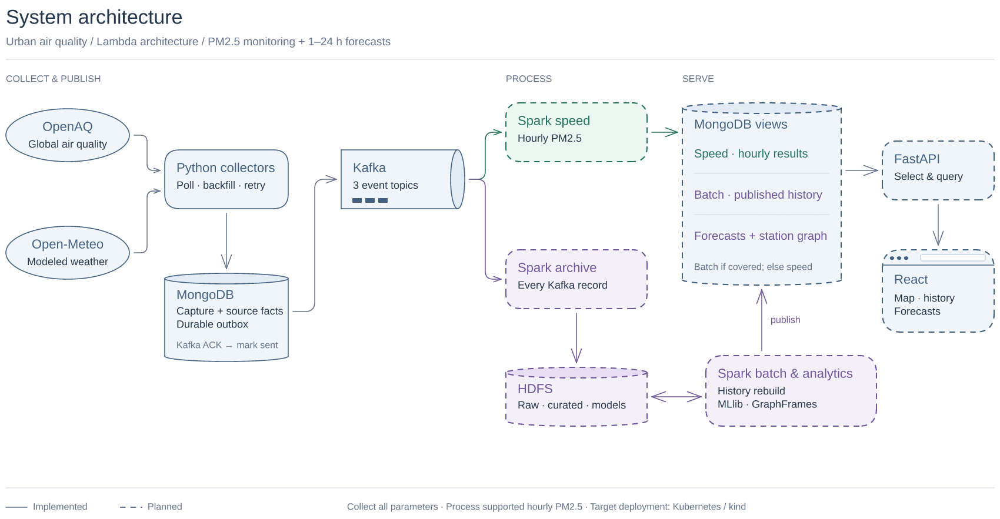
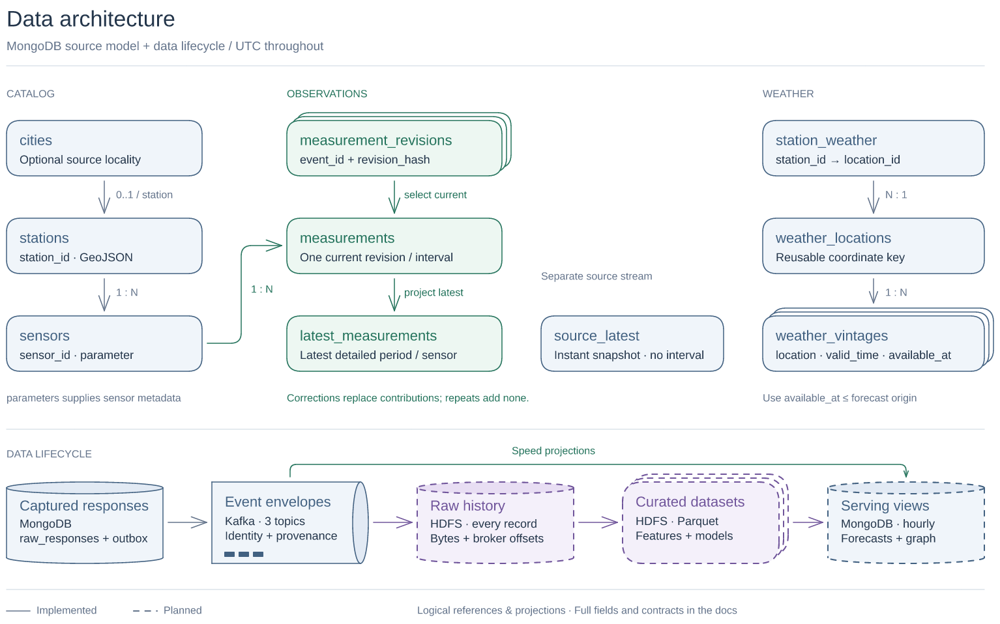

# Architecture diagrams

Two focused views describe the Urban Air Quality design: the services that move and process data, and the data identities and storage lifecycle. Field definitions, schedules, sizing and recovery policies stay in the linked documentation.

Read the [design rationale](design-rationale.md) for the reasons behind the architecture, its tradeoffs, and the diagrams' shapes and visual conventions.

| View | Editable drawing | Report images |
| --- | --- | --- |
| System architecture | [Excalidraw](system-architecture.excalidraw) | [PNG](system-architecture.png) · [SVG](system-architecture.svg) |
| Data architecture | [Excalidraw](data-architecture.excalidraw) | [PNG](data-architecture.png) · [SVG](data-architecture.svg) |
| Deployment architecture | [Excalidraw](deployment-architecture.excalidraw) | [PNG](deployment-architecture.png) · [SVG](deployment-architecture.svg) |

[overall-architecture.excalidraw](overall-architecture.excalidraw) combines the three views in named frames. The deployment view is unchanged by the system/data redraw.

## System architecture

Read left to right. Independent collectors capture provider responses and source facts in MongoDB, then publish the durable outbox to Kafka. Publication is marked complete after the Kafka acknowledgement; repeat delivery remains possible.

Kafka feeds independent **speed** processing and **raw archival**. Bounded Spark batch and analytics jobs read/write HDFS and publish corrected history, MLlib forecasts and GraphFrames results. The bidirectional HDFS link represents reads and writes; these jobs need not run together.

The MongoDB boxes show responsibilities within the same logical database. FastAPI selects batch results only when a published generation covers that key's latest processed input; otherwise it uses speed results. It also reads catalog/weather facts, an ancillary link omitted for clarity. API/dashboard arrows show result flow.

## Data architecture

The upper view shows selected MongoDB references and projections:

- **Catalog:** stations optionally reference a source locality in `cities` and have many sensors. `parameters` supplies sensor metadata.
- **Observations:** sensors have many interval observations. `measurement_revisions` retains distinct content; `measurements` selects one current revision per event; `latest_measurements` projects the latest detailed period per sensor. `source_latest` is an independent instant snapshot without a reporting interval.
- **Weather:** `station_weather` references a station and a reusable `weather_locations` coordinate key. Locations have many fetch vintages. Forecast features must use vintages available by their forecast origin. The station-to-mapping reference is expressed by its key instead of a line across the observation chain.

The lower view shows storage lifecycle. Green represents speed projections. Archival preserves every Kafka record, including invalid input and broker coordinates, before producing curated datasets. `raw_responses` and `collector_outbox` are separate collections. Planned serving collections are `speed_hourly_views`, `batch_hourly_views`, `predictions` and `graph_results`; final derived schemas remain pending.

## Status and contracts

Solid application outlines indicate implemented components/source collections; dashed outlines indicate planned components/datasets. External providers also use solid outlines. This describes implementation status, not deployment health. Collection covers all OpenAQ locations and parameters; initial aggregation supports stationary, UTC-aligned hourly PM2.5 observations.

Cylinders represent persistent storage, queue profiles represent Kafka transport, stacked documents represent retained versions or datasets, and the browser frame represents React. These shapes are schematic; their layers do not indicate replication or partition counts.

Corrections replace earlier contributions, including invalidating corrections; repeated deliveries add none. Batch publication requires a committed archive cutoff and successful validation. Failure retains the previous published generation. Full definitions remain in:

- [System design](../system-design.md): Lambda selection, processing, analytics and deployment.
- [Data contracts](../data-contracts.md): identities, revisions, quality, transport/archive and serving rules.
- [MongoDB schema](../mongodb-schema.md): exact collections, fields, indexes and bounded reads.
- [Collector operations](../collectors.md): jobs, budgets, recovery and outbox publication.

## Editing

Drag a `.excalidraw` file into Excalidraw. Cards group native shapes and text; ungroup to edit their parts. Connectors bind to endpoint shapes. Use the combined drawing to compare views, and PNG/SVG exports in reports.

The system and data views were redrawn with the Excalidraw skill CLI and visually checked with its headless renderer. Previews are exports of the editable scenes.
