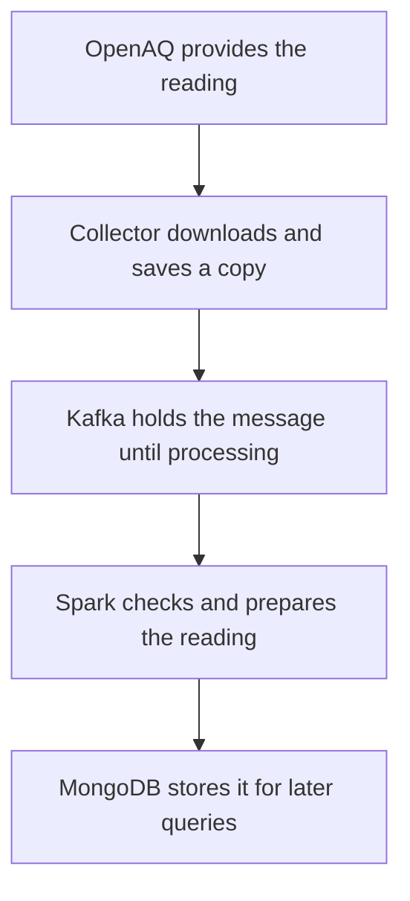

# Worked examples: follow one air-quality reading

Imagine a station beside a busy road. We will call it **Station A**.
One of its sensors measures PM2.5: tiny particles in the air.
The names and numbers below are made up to explain the system.

**What works today:** the system collects readings, checks them and stores them.
Calculating station averages works in a separate local demonstration.
The dashboard, forecasting and long-term history processing are still planned.

## 1. A reading arrives

The data provider, OpenAQ, reports:

> Station A's sensor measured an average PM2.5 concentration of
> **40 µg/m³ between 08:00 and 09:00**.

Here, µg/m³ is the unit for the amount of particles in the air.
For this example, all times use UTC, the system's common time zone.

Our system downloads the reading at 09:05. The reading still describes
**08:00–09:00**, even though we received it later.



Follow the reading through these five steps:

1. **OpenAQ supplies the data.** It tells us the station, sensor, hour, value and unit.
2. **The collector downloads it.** It saves the original response and records that the reading needs to be sent onward. This helps it recover after an interruption.
3. **Kafka holds the message.** Think of it as an inbox between the collector and Spark. If processing falls behind, the collector can keep sending messages while Kafka has space and retains them.
4. **Spark checks the reading.** It checks that the information makes sense, makes supported units consistent and marks any problems. For this valid reading, 40 stays 40.
5. **MongoDB stores the result.** The system can now look up the reading for Station A and that hour. The collector's saved responses and pending work are kept separately from these queryable results.

**At the end of today's pipeline, we have a stored, checked reading.**
It does not appear on a dashboard yet, because that part is still to be built.

## 2. Why does the data design keep several kinds of records?

Imagine three questions someone might ask:

| Question | What the system keeps | Name in the data diagram |
| --- | --- | --- |
| Where is this station, and what does its sensor measure? | Station and sensor descriptions. | `stations`, `sensors` |
| What value do we currently have for this sensor and hour? | The selected version of the reading. | `measurements` |
| Did the provider change that reading? | The different versions we received. | `measurement_revisions` |
| What is the newest measured period for this sensor? | A shortcut to its latest detailed reading. | `latest_measurements` |

These are different ways to answer questions about the same data.
The station description does not need to contain its entire reading history.

## 3. The same reading arrives twice

At 09:10, the collector receives the same **40 for 08:00–09:00** again.
This can happen because it checks overlapping time ranges or retries a message.

The system recognizes that this is the same sensor, hour and content.
It keeps **one logical reading**, so receiving the message twice does not
make that sensor count twice in an average.

Think of receiving the same email twice: it is still one piece of information.

## 4. The provider corrects 40 to 42

At 09:20, the provider changes the reading for that same sensor and hour:

> The correct value for 08:00–09:00 is **42 µg/m³**.

The system keeps the original 40 in its version history and selects 42 as the
current value. If the earlier message is later retried with its original timing
information, it does not replace the correction.

| What arrived | Current value | Versions kept |
| --- | --- | --- |
| First reading: 40 | 40 | 40 |
| Same reading again: 40 | 40 | 40 |
| Later correction: 42 | 42 | 40 and 42 |

This is why the design keeps both a current reading and its past versions.

## 5. Spark finds a problem

Receiving a well-organized API response does not automatically make every
reading suitable for our calculations.

| Input | What the system does |
| --- | --- |
| `0.035 mg/m³` | Converts it to `35 µg/m³` so supported readings use the same unit. |
| A missing value | Keeps it and marks the value as missing. |
| `-5 µg/m³` | Keeps it and marks it as unsuitable under our current PM2.5 rules. |
| A reading covering 30 minutes | Keeps it, but marks it as outside our current one-hour calculation rules. |
| A message that cannot be understood | Saves it separately with an explanation of the problem. |

**Zero is a valid reading. A missing reading is not zero.**

Spark already performs these checks and stores the results. Our local average
calculation excludes readings marked as unsuitable. That calculation still needs
to be added to the running Spark pipeline.

## 6. How would a station average be calculated?

Suppose Station A has two usable sensors for the same hour:

| Sensor | PM2.5 reading |
| --- | --- |
| Sensor 1 | 42 µg/m³ |
| Sensor 2 | 38 µg/m³ |

The station average is **(42 + 38) ÷ 2 = 40 µg/m³**.

If Sensor 1 is later corrected to “missing,” only Sensor 2 remains usable.
The average becomes **38 µg/m³**, based on one sensor. The old 42 must stop
contributing to the calculation.

If neither sensor has a usable reading, there is no usable average for that hour.
That does not tell us the air was clean.

This rule works in the local demonstration today. Spark stores the individual
readings today, but does not yet calculate these station averages automatically.

## 7. Weather enters alongside air-quality data

The weather provider, Open-Meteo, supplies information such as temperature and
wind for the station's area. Weather follows the same basic journey:
**collector → Kafka → Spark → MongoDB**.

The system remembers which weather location belongs to Station A. Nearby
stations can share a weather location while keeping their own pollution readings.
This connection will let future analysis compare air quality with local weather.

It also remembers when weather information was downloaded:

- At 09:55, we download a prediction of **25 °C at noon**.
- At 10:15, we download an updated prediction of **26 °C at noon**.

When evaluating a pollution forecast made at 10:00, we can use the first weather
prediction. We cannot use the second one: our system did not have it yet.
Keeping both versions helps us avoid giving a historical forecast information
from the future.

Weather storage works today. Pollution forecasting is still planned.

## 8. What will happen after we build the rest?

The full system diagram includes two processing paths:

| Path | Purpose | Example |
| --- | --- | --- |
| Fast updates, called the speed layer | Quickly update monitoring results as readings arrive. | Show the corrected station average soon after receiving a correction. |
| Historical rechecking, called the batch layer | Recalculate results from saved history, including late readings and corrections. | Recheck yesterday's station averages. |

HDFS will hold the long-term input history used for those rechecks.
FastAPI will answer requests for results, and React will display them on the dashboard.
These parts are planned, including the automatic station averages in Spark.

For example, suppose a completed historical recheck calculated **40**, then a
new correction changes the answer to **42**:

1. The fast path will calculate 42 from the new information.
2. The API will use that updated result while the historical result is behind.
3. Once a successful historical recheck includes the correction, the API can use its result of 42.

The dashboard will show one selected answer for that station and hour, with
information about its freshness and quality.

## 9. Try the small demonstration

From the project folder, run:

```sh
python3 -m streaming.replay data/sample_measurements.jsonl
```

This runs a small made-up example without starting Kafka, Spark or MongoDB.
It prints a detailed report. Look for `hourly_metrics`, which contains these
three results:

| Station | Hour starting at, in UTC | PM2.5 average |
| --- | --- | --- |
| Demo station 1 | 00:00 | 42 µg/m³ — a correction replaced 40. |
| Demo station 1 | 01:00 | 35 µg/m³ — converted from milligrams. |
| Demo station 2 | 00:00 | 0 µg/m³ — zero was kept as a valid value. |

The demonstration uses different station names and hours from the story above,
but follows the same rules.

For more detail, see the [system diagram](system-architecture.png),
[data diagram](data-architecture.png), [pipeline guide](../streaming.md) or
[data storage reference](../mongodb-schema.md).
