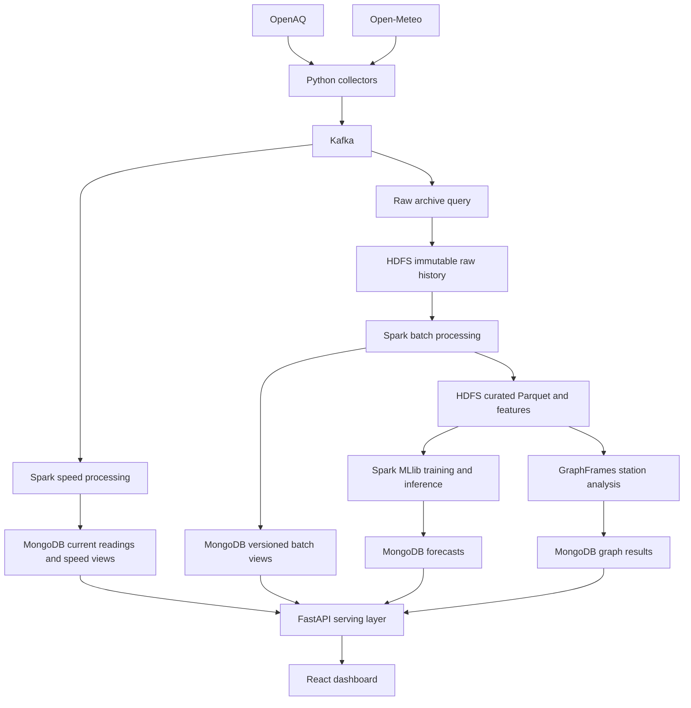

# Urban Air Quality System — Detailed Design Plan

Status: agreed design; a local hourly PM2.5 replay and regression tests are implemented. Source feasibility and distributed components remain pending.

This document records the detailed design agreed for the milestone project. It supersedes the preliminary technology choices; the architecture, data-contract, and implementation notes now follow this stack and describe the first executable local slice.

## 1. Architecture and objectives

Build an end-to-end **Lambda Architecture** for PM2.5 monitoring and 1–24-hour concentration forecasting:

- **Speed layer:** process incoming events and provide fresh monitoring results.
- **Batch layer:** retain raw history and periodically recompute corrected, authoritative results.
- **Serving layer:** combine both views for the API and dashboard.

This matches Lambda's separate batch and streaming processing paths. Both paths will share validation and business logic to keep their results consistent. [Architecture reference](https://learn.microsoft.com/en-us/azure/architecture/databases/guide/big-data-architectures#lambda-architecture)

The assessed stack will be **PySpark, Kafka, HDFS, MongoDB, and Kubernetes**, with Spark MLlib and GraphFrames for advanced analytics.

Agreed defaults:

- Local Kubernetes using **kind**.
- One pilot city and 3–5 active stations, selected after checking coverage; prefer Vietnam.
- PM2.5 concentration monitoring and forecasting first; AQI is a later extension.
- React dashboard using FastAPI.
- Real historical data for analysis and model evaluation.
- Separate, clearly labeled generated workloads for performance testing.

## 2. Components and data flow

### Component responsibilities

| Component | Responsibility |
| --- | --- |
| Configuration | Selected stations, sensor cadence, polling intervals, units, quality rules, processing settings, and model parameters. |
| Collectors | Poll OpenAQ and Open-Meteo independently; paginate, retry, track progress, and publish events. |
| Kafka | Buffer events, preserve partition order, and allow independent archival and processing progress. |
| Raw archive query | Write every Kafka record to HDFS, including invalid records and broker coordinates needed for audit and replay. |
| Spark speed processing | Validate events, normalize units, maintain current readings, and recompute affected hourly monitoring results. |
| Spark batch processing | Rebuild corrected history from archived events and produce hourly/daily analytics and feature datasets. |
| HDFS | Store raw history, curated Parquet, checkpoints, models, and processing evidence. |
| MongoDB | Store indexed dashboard views, forecasts, station metadata, graph results, and processing control records. |
| ML pipeline | Prepare features, train and evaluate Spark MLlib models, and generate hourly forecasts. |
| Graph pipeline | Analyze spatial and statistical relationships between stations. |
| FastAPI | Select appropriate serving views and expose bounded monitoring and analytics queries. |
| React | Display station readings, history, forecasts, quality, freshness, and station relationships. |
| Kubernetes | Run services, manage configuration and persistent volumes, and schedule bounded jobs. |

### Collection and processing defaults

- Poll air-quality measurements every **15 minutes** and weather every **hour**.
- Use an overlapping measurement lookback to detect delayed records and corrections.
- Maintain a shared API request budget for live polling and historical backfill; honor rate-limit headers and `429` responses. OpenAQ currently documents limits of 60 requests/minute and 2,000/hour. [OpenAQ limits](https://docs.openaq.org/using-the-api/rate-limits)
- Run the speed query every **30 seconds** and raw archiving every **60 seconds**.
- Reconcile the latest seven days hourly; rebuild the complete configured historical period nightly.
- Start with 90 days of usable real history and target 180 days.

Select stationary sensors with known reporting intervals. OpenAQ measurements can already represent hourly averages, so processing must retain their source periods and avoid treating each poll as a new measurement. [OpenAQ measurement semantics](https://docs.openaq.org/resources/measurements)

### Kubernetes deployment

Use one namespace, one control-plane node, and two kind worker nodes:

- One Kafka broker/controller in KRaft mode.
- HDFS: one NameNode and three DataNodes, replication factor three, with separate persistent volumes.
- One MongoDB instance with persistent storage.
- One long-running Spark application with two executors for archival, speed processing, and stream diagnostics.
- Kubernetes Jobs/CronJobs for batch processing, training, inference, and graph analysis.
- FastAPI and React Deployments.
- ConfigMaps, Secrets, health probes, resource limits, and a restricted Spark service account.

Spark will run directly on Kubernetes, without a separate Spark standalone cluster or YARN. [Spark deployment documentation](https://spark.apache.org/docs/3.5.8/running-on-kubernetes.html)

Reserve approximately **10–12 GiB of available memory** and **60 GiB of disk** for assessment runs. Allow only one bounded Spark analytics job at a time. These are initial sizing assumptions to verify during the infrastructure milestone.

HDFS replication demonstrates distributed storage across DataNode processes. Because kind runs on one physical workstation, this deployment demonstrates process recovery and replication, without providing machine-level availability. [HDFS architecture](https://hadoop.apache.org/docs/r3.4.0/hadoop-project-dist/hadoop-hdfs/HdfsDesign.html)

## 3. Data contracts, serving rules, and reliability

### Events and storage

Use two initial topics:

| Topic | Event representation | Partition key |
| --- | --- | --- |
| `air_quality_raw` | One source sensor measurement, including its reporting interval. | Source-qualified station ID |
| `weather_raw` | One location/valid-hour weather record, retaining model provenance and fetch vintage. | Weather location key |

Start with three partitions per topic, seven-day retention, and replication factor one for the local broker.

Every event includes:

- Schema version, source, station/location identity.
- Stable observation identity and payload revision hash.
- Observation or valid time, source period, collection time, and ingestion time.
- Original values, units, quality metadata, and provider payload.
- Weather issue time when supplied; recorded availability time otherwise.

Use UTC internally. Keep weather location mappings separate from station identities, and label modeled weather appropriately.

**HDFS organization:** raw data partitioned by source and ingestion date; curated data by observation date; versioned feature/model datasets; separate checkpoint and benchmark directories. Preserve original events and revisions rather than overwriting raw history.

**MongoDB collections:** stations, measurement revisions, current measurements, weather vintages, speed hourly views, batch hourly views, predictions, graph results, and control/publication state.

Use regular MongoDB collections with deterministic keys and compound indexes for station/time queries. This supports explicit uniqueness and retry-safe updates; MongoDB time-series collections restrict unique indexes. [MongoDB limitations](https://www.mongodb.com/docs/manual/core/timeseries/timeseries-limitations/)

### Corrections and Lambda reconciliation

- Repeated observations reuse the same logical identity.
- Changed values create revision records.
- Prefer an ordered upstream revision when available; otherwise use recorded collection time with a deterministic tie-breaker.
- Replayed events preserve their original provenance and ordering metadata.
- Current projections reject older revisions.
- After updating current measurements, speed processing recomputes affected station/hour groups from the complete deduplicated readings. Corrections therefore replace earlier contributions.

Batch jobs read a fixed, committed archive snapshot and record its Kafka offset cutoff for each partition. They write a new generation of results and publish it only after all outputs and checks succeed.

For each hourly key, FastAPI:

1. Uses the batch result when it covers that key's latest processed input.
2. Uses the speed result when that key changed after the batch cutoff.
3. Falls back to the speed result when no batch result exists.

Each response exposes whether the result is provisional or batch reconciled. A failed batch leaves the previous published generation available.

### Streaming state and delivery guarantees

Keep stateful stream diagnostics separate from correction-aware monitoring:

- **Append mode:** immutable raw archival.
- **Update mode:** event-time quality and arrival summaries with a 24-hour watermark.
- **Complete mode:** cumulative arrival totals for the bounded configured station inventory.

Late records excluded from watermarked diagnostics remain in the raw archive and current-reading processing path. Batch reconciliation includes them.

Give each streaming query its own durable HDFS checkpoint. Retry MongoDB writes with deterministic keys and guarded updates; record batch completion only after all writes succeed.

The guarantee is **at-least-once delivery with exactly-once logical effects for the tested projections**. It does not imply one atomic transaction spanning Kafka, HDFS, and MongoDB. Spark's `foreachBatch` sink requires explicit deduplication/idempotency for stronger write guarantees. [Spark fault-tolerance documentation](https://spark.apache.org/docs/3.5.8/structured-streaming-programming-guide.html#using-foreach-and-foreachbatch)

### API and dashboard interfaces

Retain the existing monitoring routes and add pipeline and graph visibility:

| Route | Purpose |
| --- | --- |
| `/health`, `/ready` | Liveness and MongoDB serving readiness. |
| `/api/v1/stations` | Station inventory, coordinates, sensor coverage, and source attribution. |
| `/api/v1/stations/{id}/latest` | Latest usable concentration and freshness. |
| `/api/v1/stations/{id}/history` | Hourly concentrations, coverage, quality, and serving provenance. |
| `/api/v1/stations/{id}/weather` | Associated weather with provenance and vintage. |
| `/api/v1/stations/{id}/predictions` | Latest forecast origin, horizons, model, and input freshness. |
| `/api/v1/analytics/station-network` | Station relationships and graph results. |
| `/api/v1/pipeline/status` | Collector progress, processing lag, archive progress, and batch publication status. |

History defaults to 24 hours, permits at most 90 days per query, and uses cursor pagination capped at 1,000 rows. Responses expose units and UTC timestamps. Missing values remain null.

Mark readings stale after three expected reporting intervals, with a minimum threshold of two hours. React refreshes every 30 seconds and shows source age separately from pipeline delay.

## 4. Spark rubric and analytics design

Every listed technique receives an implementation, expected result, and saved evidence.

| Requirement | Planned demonstration |
| --- | --- |
| Window functions and advanced aggregations | Hourly/daily statistics, lag features, rolling means, standard deviation, percentiles, and station rankings. |
| Pivot and unpivot | Unpivot hourly weather variables into a long representation; pivot them into feature columns. |
| Custom aggregation | A batch Pandas aggregate UDF calculating a coverage-weighted concentration statistic for bounded station/day groups. |
| Multistage transformations | Parse → validate → normalize → resolve revisions → enrich → aggregate → prepare features. |
| Custom business UDF | Classify measurement quality from source flags, validity, units, and reporting metadata; compare its cost with native expressions where equivalent. |
| Broadcast joins | Enrich measurements with small station, location-mapping, and unit-policy datasets. |
| Sort-merge joins | Join historical pollution and weather fact datasets on location and valid hour. |
| Multiple-join optimization | Filter and project first, align join keys, broadcast dimensions, and compare physical plans. |
| Partition pruning | Restrict date-partitioned Parquet reads and verify reduced scanned files/bytes. |
| Bucketing | Create catalog-registered Parquet fact tables, bucketed and sorted by shared join keys, inside the benchmark job. |
| Caching and persistence | Persist reused cleaned/features datasets with `MEMORY_AND_DISK`; measure reuse and unpersist afterward. |
| Query plans | Save `explain("formatted")`, Spark event logs, and before/after join and scan metrics. |
| Streaming modes, watermarks, and state | Demonstrate the three queries above, late-event behavior, checkpoint recovery, and state eviction. |
| Exactly-once guarantees | Inject failures and prove unchanged logical identities, counts, aggregates, and published generations after retries. |
| Spark MLlib | Train and evaluate a concentration forecasting pipeline against persistence. |
| GraphFrames | Build a station relationship graph and calculate connected components. |
| Statistical/time-series analysis | Calculate trends, variability, paired station correlations, and forecast errors by horizon. |

Join hints and adaptive execution can change the chosen physical plan. Evidence must show the actual executed strategy and measured result; bucketing or caching must not be claimed to improve performance without measurements. [Spark optimization guidance](https://spark.apache.org/docs/3.5.8/sql-performance-tuning.html)

### Forecasting

Use a Spark MLlib pipeline with feature assembly, training-only imputation, and a **GBTRegressor**. Train one pooled direct forecasting model with horizon `1..24` as an input feature.

Features include past pollution lags, rolling statistics, past available weather, calendar variables, station coordinates, and input-age indicators. Preserve feature definitions and model versions.

- Use chronological training, validation, and test periods with a 24-hour gap between partitions.
- Compare MAE/RMSE against persistence for every horizon.
- Historical publication times may be unknown; label initial historical evaluation as retrospective and document availability assumptions.
- Validate genuine availability-aware behavior with archived live vintages and forward evaluation.
- Run inference hourly; expose missing forecasts when inputs fail freshness or coverage checks.
- Deploy the learned model only if evaluation supports it; otherwise serve the labeled baseline.

### Station graph

Create vertices from real station metadata. Create edges for stations within 25 km whose concentration correlation is at least 0.6, using at least 168 paired usable hourly observations. Store distances, correlations, sample counts, and connected-component membership.

An empty graph is a valid result. Describe edges as observed relationships, without implying pollution transport or causation.

Use a compatible Spark/Scala dependency set. A concrete baseline is Spark 3.5.8, Scala 2.12, Java 17, MongoDB Spark Connector 10.7.0, and GraphFrames 0.12.3. [MongoDB compatibility](https://www.mongodb.com/docs/spark-connector/v10.x/), [GraphFrames installation](https://graphframes.io/02-quick-start/01-installation.html)

## 5. Delivery milestones and acceptance tests

| Milestone | Deliverable and completion condition |
| --- | --- |
| 1. Executable rules and source feasibility | Run a local fixture through validation, revision selection, and hourly aggregation with regression checks; record selected real sensors, cadence, history, and API access. The local replay is implemented; source feasibility remains pending. |
| 2. Kubernetes infrastructure | Kafka, HDFS, MongoDB, and Spark start reproducibly; two executors process tasks and HDFS reports three replicas. |
| 3. Ingestion and archive | Both sources reach Kafka; progress survives collector restarts; archived records retain provenance and support replay. |
| 4. Monitoring path | Speed processing, FastAPI, and React show concentrations, history, missing data, and freshness. |
| 5. Batch serving | Corrected history is published safely; serving switches between speed and batch views without duplicate hours. |
| 6. Advanced analytics | Every rubric demonstration runs; MLlib forecasts and GraphFrames results are available through the API. |
| 7. Assessment package | Include startup instructions, architecture explanation, evidence, benchmark report, failure demonstrations, and limitations. |

Required verification scenarios:

- Repeated polling and repeated Spark batches leave concentration counts unchanged.
- Corrections replace earlier values, including corrections to historical hours.
- Records arriving before and beyond the diagnostic watermark have documented outcomes.
- Invalid units and source flags produce visible quality failures; raw events remain recoverable.
- Failure midway through MongoDB writes recovers without missing or duplicated logical results.
- Failure before batch publication preserves the previous generation.
- Driver/executor restarts recover from checkpoints; a DataNode restart demonstrates replicated reads.
- Archive replay into an isolated namespace reproduces expected results.
- Forecast features respect temporal splits and recorded availability where available.
- API pagination, stale data, missing predictions, and partial coverage render correctly.

Benchmark at **100,000, 1 million, and 5 million events** in an isolated dataset. Record dataset bytes, throughput, processing latency, shuffle volume, spill, scanned partitions, and executor memory. Generated events must never enter real model evaluation or monitoring results.

The initial monitoring target is **p95 Kafka-to-serving latency below two minutes** under the controlled pilot workload. Report source publication delay separately.

Update the existing project documentation consistently: Kubernetes becomes the assessed deployment; HDFS supplies distributed storage; MongoDB becomes the serving database; Spark MLlib supplies the initial learned model. Preserve the repository's small component structure while adding the explicit batch path and assessment evidence.
